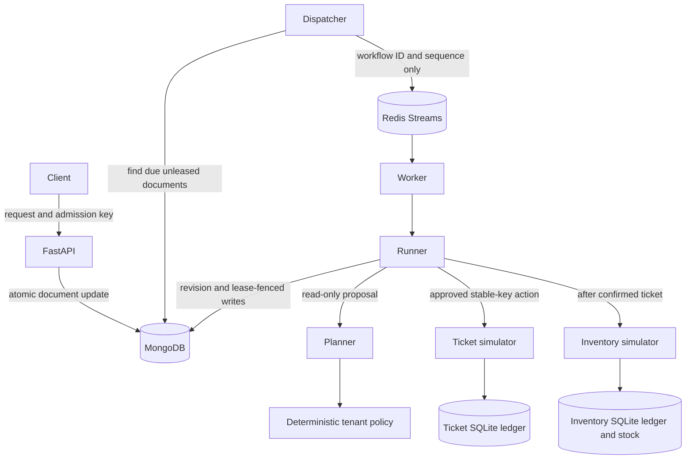

# Architecture

## Responsibilities

The runner has one public operation, `tick(workflow_id, worker_id)`. It claims eligible work, performs one phase with at most one external mutation, saves the result under its lease, then releases that lease. API handlers do not duplicate the state machine. The broker does not decide which action to execute.

The domain returns new validated snapshots without I/O. The store checks revisions, current tokens and immutable fields, then updates selected document fields. This keeps heartbeat and enqueue changes from being overwritten by a worker's older snapshot.

The store interface has two implementations: a clock-injected memory fake for deterministic tests, and MongoDB for real concurrency and persistence. The planner interface has a fixture adapter and an OpenAI-compatible model adapter. Gateways are injected into the runner. These are actual interchangeable implementations rather than speculative plugin layers.

## State ownership

Each workflow contains its request, plan, approval, action identities, bounded attempt counts, due intent, lease and at most 256 history entries. The serialized document budget is 256 KiB. There is no separate outbox collection or cross-store transaction.

## Concurrency

- MongoDB server time controls leases and retry eligibility.
- Semantic changes increment revision. Lease renewal and dispatch markers do not.
- Lease duration is 30 seconds; heartbeats run every 5 seconds.
- The dispatcher scans once a second and republishes each eligible workflow no more than once per 5 seconds.
- Redis abandoned pending entries are reclaimed after 60 seconds. MongoDB redispatch independently covers Redis loss.
- API commands fail on conflicting revisions or live leases. Same-hash approval replay is idempotent even with an earlier revision.

An expired worker may still be executing at a downstream system. Its token prevents stale local writes. Only the downstream same-key contract prevents duplicate external effects. These guarantees solve different problems.

## Model restrictions

The model receives request text and one authorized catalog snapshot. It returns either a typed plan or clarification questions. The policy independently resolves explicit references and compares asset, priority, reservation intent, part and quantity against a limited grammar. The compiled reservation obtains its ticket ID from the confirmed ticket action, never from model output.

Approval authorizes the immutable hash of schema version, catalog version and canonical validated plan JSON. Later catalog changes do not rewrite an approved plan in this MVP. Catalog mutation is not a public endpoint.

## Failure handling

External timeouts, malformed success responses and unclassified server errors are ambiguous. Lookup uses the original key. Confirmed and skipped results are durable; unavailable lookup is bounded. Safe same-key replay requires an advertised deduplication contract. Limits are five mutation submissions, five lookups per ambiguous episode and two planner calls per workflow.

See [consistency.md](consistency.md) for partial outcomes, cancellation and assumptions. See [build-log.md](build-log.md) for implementation decisions and actual verification progress.
