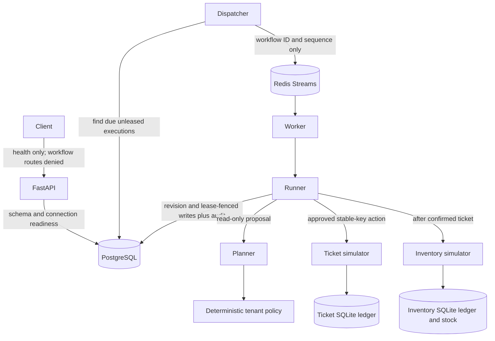

# Architecture

## Responsibilities

The runner has one public operation, `tick(workflow_id, worker_id)`. It claims eligible work, performs one phase with at most one external mutation, saves the result under its lease, then releases that lease. API handlers do not duplicate the state machine. The broker does not decide which action to execute.

The domain returns new validated snapshots without I/O. The store checks revisions, current tokens and immutable fields, then updates selected fields. This keeps heartbeat and enqueue changes from being overwritten by a worker's older snapshot. Generic admission can create only unapproved planning work. General saves cannot introduce approval, including leased worker saves. Pure domain approval remains available for a future transaction-owned review bridge and isolated owner test fixtures, not an API/CLI command.

PostgreSQL is the only default runtime store. Each operation opens a short independent session; tick and heartbeat never share one. A clock-injected memory fake proves domain rules, not PostgreSQL concurrency. The MongoDB adapter remains historical. The planner has fixture and OpenAI-compatible model adapters, and gateways are injected into the runner.

Phase 1 HTTP exposes public health but closes standalone admission/direct approval with 410 and protected reads/cancellation with 401. There is no API-key fallback, cookie identity, legacy factory or approval fixture setting. Runtime construction accepts only a runtime PostgreSQL URL or bounded raw-URL file. Schema initialization verifies the migration head without DDL. CLI init does not construct executor clients.

## State ownership

`compose.postgres.yaml` separates eight long-running services from explicit preparation/migration jobs. A private administrator volume holds the started journals and canonical allocation; only preparation and PostgreSQL mount it. The migration job mounts only the owner credential volume. API, dispatcher and both worker services mount only the runtime credential volume, read-only. Neither application startup nor ordinary Compose `up` runs DDL. The production image contains no tests or fixture approval command; the executor's privileged setup exists only in an explicitly selected test image/override.

Preparation persists an exclusive started marker before fresh allocation, then fsyncs a canonical record before atomically publishing separate owner/runtime files. Repeated explicit preparation verifies the recorded database, role properties, credential identities and runtime binding. A missing consumer file can be republished from the same canonical identity; a mismatched file is not overwritten. An interrupted pre-canonical bootstrap remains a visible recovery condition. No prefix scan, existing-role repair, password rotation or deletion of a committed deployment is part of preparation.

Each execution contains its request, plan, approval, action identities, bounded attempt counts, due intent, lease and at most 256 history entries. The full serialized snapshot budget is 256 KiB. Column-backed fields and one JSONB payload form one authoritative execution record. Semantic changes append audit within the same transaction; audit is not trimmed with operational history. There is no cross-store transaction.

## Concurrency

- PostgreSQL server time controls leases and retry eligibility.
- Semantic changes increment revision. Lease renewal and dispatch markers do not.
- Lease duration is 30 seconds; heartbeats run every 5 seconds.
- The dispatcher scans once a second and republishes each eligible workflow no more than once per 5 seconds.
- Redis abandoned pending entries are reclaimed after 60 seconds. PostgreSQL redispatch independently covers Redis loss. Fresh default names are `workflow-pg-wakeups-v1` and `workflow-pg-workers-v1`.
- Internal saves reject conflicting revisions and live foreign leases. Public workflow commands remain denied pending identity and review.

An expired worker may still be executing at a downstream system. Its token prevents stale local writes. Only the downstream same-key contract prevents duplicate external effects. These guarantees solve different problems.

## Model restrictions

The model receives request text and one authorized catalog snapshot. It returns either a typed plan or clarification questions. The policy independently resolves explicit references and compares asset, priority, reservation intent, part and quantity against a limited grammar. The compiled reservation obtains its ticket ID from the confirmed ticket action, never from model output.

Approval authorizes the immutable hash of schema version, catalog version and canonical validated plan JSON. Later catalog changes do not rewrite an approved plan in this MVP. Catalog mutation is not a public endpoint.

## Failure handling

External timeouts, malformed success responses and unclassified server errors are ambiguous. Lookup uses the original key. Confirmed and skipped results are durable; unavailable lookup is bounded. Safe same-key replay requires an advertised deduplication contract. Limits are five mutation submissions, five lookups per ambiguous episode and two planner calls per workflow.

See [consistency.md](consistency.md) for partial outcomes, cancellation and assumptions. See [build-log.md](build-log.md) for implementation decisions and actual verification progress.
