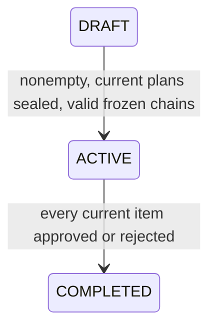
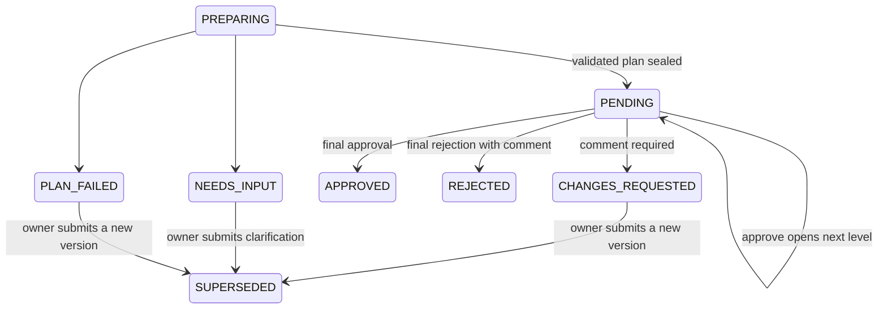
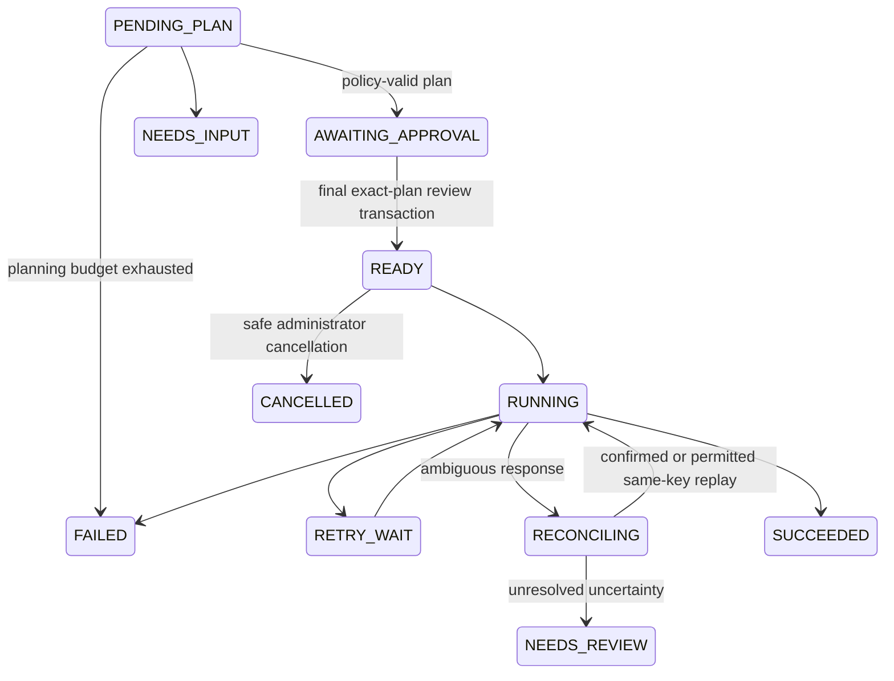

# Approval review runbook

This is the current PostgreSQL review application. The old API-key demo, MongoDB deployment and measured load reports are historical. Do not repoint their streams, databases or simulator ledgers at this release. No import or production cutover is included.

## Fresh local Compose setup

Use Docker Desktop with Linux containers and Compose v2. Choose a new project name and keep it for every subsequent command. Run from the repository root:

```sh
docker compose -f compose.postgres.yaml -p review-demo build api
docker compose -f compose.postgres.yaml -p review-demo run --rm --no-deps prepare admin
docker compose -f compose.postgres.yaml -p review-demo up -d --wait postgres redis
docker compose -f compose.postgres.yaml -p review-demo run --rm --no-deps prepare roles
docker compose -f compose.postgres.yaml -p review-demo run --rm --no-deps migrate
docker compose -f compose.postgres.yaml -p review-demo up -d --wait
```

Preparation generates credentials inside private Docker volumes. Never print or copy those files into a terminal transcript, `.env`, build context or uploaded artifact. The application runs as UID 10001 with only its runtime URL mounted read-only. The migration process receives only the owner URL; preparation alone receives administrative access. Docker and host administrators remain trusted.

Default addresses:

| Service | Loopback address |
| --- | --- |
| Application | http://127.0.0.1:18000 |
| Mailpit inbox | http://127.0.0.1:18025 |
| Captured SMTP | 127.0.0.1:11025 |
| Ticket / inventory simulator | http://127.0.0.1:18001 / http://127.0.0.1:18002 |
| PostgreSQL / Redis | 127.0.0.1:15432 / 127.0.0.1:16379 |

The Compose file explicitly selects local HTTP mode. Use the exact application origin above, not a different hostname. For another port, set both `WORKFLOW_PG_API_PORT` and `WORKFLOW_PG_ORIGIN`. Other overrides are `WORKFLOW_PG_MAILPIT_PORT`, `WORKFLOW_PG_SMTP_PORT`, `WORKFLOW_PG_TICKET_PORT`, `WORKFLOW_PG_INVENTORY_PORT`, `WORKFLOW_PG_DB_PORT` and `WORKFLOW_PG_REDIS_PORT`. A dedicated non-secret `--env-file` must be passed consistently to every command. Do not reuse the historical `.env`.

## Seed the disposable demo

On a fresh identity database, run explicitly:

```sh
docker compose -f compose.postgres.yaml -p review-demo exec -T -e WORKFLOW_ALLOW_DEMO_SEED=true api workflow-engine seed-demo
```

The JSON output contains eight generated passwords, shown once. Keep them privately, outside repository files and CI logs. They are not committed defaults and cannot be recovered by rerunning the seed. Each tenant has these logins:

| Tenant | Administrator | Requester | Reviewers |
| --- | --- | --- | --- |
| tenant-a | tenant-a.admin | tenant-a.requester | tenant-a.reviewer-1, tenant-a.reviewer-2 |
| tenant-b | tenant-b.admin | tenant-b.requester | tenant-b.reviewer-1, tenant-b.reviewer-2 |

Each tenant has seven cycles: **Draft setup**, **First-level review**, **Second-level review**, **Changes and resubmission**, **Rejected request**, **Overdue review** and **Completed approvals**. The changes example retains the older decisions and a newer version waiting at level one. Completed approvals may still be executing; cycle completion is not an external-success claim.

Repeat safety uses a versioned `demo_seed_records` journal, a session advisory lock and persisted UUID manifest, not predictable object IDs. A successful rerun returns `created=false`, the same manifest and no passwords. It does not recreate missing records, reset passwords, rename edited cycles, change decisions or reset simulator stock. A conflicting manifest, concurrent seed or interrupted `STARTED` journal fails explicitly. Inspect that exact deployment; do not delete its journal or retry with a reset. Lost one-time output has no automated password-recovery path. A new disposable project is an alternative only when abandoning the old demo is intentional.

Seeding requires both `WORKFLOW_ENV=local` and `WORKFLOW_ALLOW_DEMO_SEED=true`. It refuses a database that already has tenants/accounts without the matching completed seed journal. It uses real account, submission and decision commands and the fixture planner. Seed-command audit facts carry system actor `seed-demo` and reason `demo_seed_v1`; they are synthetic stories, not evidence of human decisions. Background execution remains normal system activity.

## Provision accounts without demo stories

Instead of seeding, bootstrap a new tenant through an interactive hidden password prompt:

```sh
docker compose -f compose.postgres.yaml -p review-demo exec api workflow-engine bootstrap-admin --tenant workshop --login workshop.admin
```

Do not use `-T` for this interactive command. The operator creates a new tenant and its initial ADMIN, not a public signup. An existing tenant/login causes a conflict without password changes. Sign in and use **Accounts** to create REQUESTER and REVIEWER identities with passwords of 12 to 256 characters, or disable/re-enable non-admin accounts. Disabling revokes sessions; re-enabling does not revive them. A disabled assigned reviewer blocks the chain until that same identity is re-enabled. There is no role editing, impersonation or administrative approval override.

The shipped catalogs/planner examples cover `tenant-a` and `tenant-b`. A separately provisioned tenant such as `workshop` also needs an operator-supplied approved catalog and matching fixture proposals before submission can produce a reviewable plan. Use `WORKFLOW_CATALOG_PATH` and `WORKFLOW_FIXTURES_PATH` in a native deployment or an explicit Compose override with the corresponding files. Bootstrap does not invent a maintenance policy for a new tenant. Use the seed procedure for the out-of-the-box demo.

## Roles and state

| Operation | ADMIN | REQUESTER | REVIEWER |
| --- | --- | --- | --- |
| Create accounts / draft cycles, admit requesters, configure chains, activate | Own tenant | No | No |
| Create item / submit or resubmit | No proxy submission | Own item in an admitted cycle | No |
| Read items / execution | Own tenant | Own items | Assigned items |
| Decide | No override | No | Exact current assigned level only |
| Download cycle reports / read tenant audit | Own tenant | No | No |
| Cancel execution | Existing safety guards | No | No |



An item's version progresses separately:



Supersession creates a separate PREPARING version and a new run; old approvals cannot authorize it. Draft owners can also replace an unapproved pending version, for example after a chain change. A live planning lease returns 409. Activated membership/definitions are frozen, rejected items are final and approved runs cannot be superseded.



This diagram is an overview, not permission to edit states directly. Safe cancellation can retain confirmed partial effects. A stock shortage is a conditional SKIPPED result. NEEDS_REVIEW has no operator-resolution endpoint in this release.

## Authentication, audit and recovery guarantees

Passwords use Argon2id with 64 MiB, three iterations and parallelism two. Verification/hashing runs off the event loop with two slots per AuthService. Sessions have random 256-bit tokens stored only as hashes, 30-minute idle and 12-hour absolute expiry, login rotation and persisted revocation. Login has a short-lived pre-session, CSRF and persisted per-account/source throttling. The server rechecks live membership rather than trusting client roles.

Native production mode requires `WORKFLOW_ORIGIN=https://your-host`. Cookies are host-only `__Host-workflow_session`, Secure, HttpOnly and SameSite=Lax. Only explicit `WORKFLOW_ENV=local` with a loopback HTTP origin permits the separate non-Secure local cookie. Unsafe commands require configured Origin and session CSRF. No CORS widening, API-key fallback or localStorage tokens. Reverse-proxy TLS termination and trusted host/rate-limit policy are operator responsibilities, not provided by the local Compose demo.

Business changes, decisions, audit and final execution due intent commit in the same PostgreSQL transaction. Runtime grants deny rewriting audit, versions, plans, steps and decisions. Audit is not truncated with the 256-entry execution diagnostic history. This is not tamper-proof against database administrators. Audit IDs/times are available to ADMIN at `/api/audit` using keyset pagination. No request text, decision comment, password or session token is copied into audit metadata.

Final approval binds the entire persisted chain to the exact current sealed plan. Worker claims verify that authorization again. General store saves, old API keys, knowing a plan hash and ADMIN access cannot mint it. Redis holds replaceable wakeups; durable scheduling is in PostgreSQL. Original action keys, current-lease fencing, bounded retries, reconciliation and retained confirmed outcomes still apply. There is no end-to-end exactly-once guarantee.

## Reminders and reports

Each opened step has a UTC deadline and at most one durable reminder job. Only an overdue, enabled, current assignee on an ACTIVE cycle is eligible. Step changes cancel unsent jobs. A temporarily disabled current reviewer defers that same job for 60 seconds without spending an SMTP attempt; re-enabling allows delivery on the next eligible poll. There are five delivery attempts with 1/2/4/8-second retry waits, a stable Message-ID and a ten-second SMTP timeout. ADMIN sees delivery state/attempts on the item.

SMTP runs outside the database transaction. A crash after acceptance before acknowledgement can repeat mail; a decision racing the final send check can still receive late mail. SMTP acceptance does not prove inbox delivery. No email authorizes a decision, and messages contain an authenticated item link rather than request content. Local mail stays in Mailpit with `.invalid` destinations. Production notification startup requires explicit authenticated STARTTLS settings. External mail delivery has not been certified by the local acceptance tests.

ADMIN can download CSV/PDF from the cycle page. Both formats use `CycleReport` from a read-only REPEATABLE READ snapshot, not a paginated UI result. Limits are 10,000 item/version query records, 50,000 audit records, 8 MiB serialized report data and 10 MiB generated output, with two render slots per API process. Decision-level expansion can produce more CSV rows than version records. Oversize requests fail with 413, never silently truncate. Separate downloads may observe different instants; each file identifies its own UTC snapshot.

Reports include all versions, assignments, decisions/comments, UTC submission/decision/current deadlines, plan hashes, review status, execution status and confirmed partial effects. Unsubmitted items include their configured draft assignments, not fabricated version steps. Audit references include related decisions, execution transitions and reminder jobs. An empty-cycle CSV contains one cycle-context/audit row with no item identity. CSV is UTF-8 with BOM, quotes multiline fields and prefixes dangerous spreadsheet formula cells. Its output-byte budget is enforced during writing, before the whole expanded file is allocated. PDF embeds Noto Sans Regular/Bold, repeats table headings and numbers pages. Unsupported font glyphs fail with 422 and guidance to use CSV, rather than silently lose text. Downloads are authenticated, no-store attachments, not public files. An export-request audit fact means requested, not fully received.

ReportLab is BSD-licensed. The bundled Noto fonts use SIL Open Font License 1.1, retained at `src/workflow_engine/fonts/OFL.txt`; see [third-party notices](third-party-notices.md). No OS fonts, Chromium or paid services are needed to generate reports.

## Restarts and migrations

Retain all six project volumes: PostgreSQL data, administrator credentials/journals, owner credentials, runtime credentials and both simulator ledgers. Never reset a downstream ledger while retaining runs that might retry. Ordinary `up -d --wait`, `restart` and `down` without `--volumes` retain state. Do not run broad Docker pruning or delete credential markers to fix an error.

For a new schema, stop `api`, `worker-a`, `worker-b`, `dispatcher` and `notifications`, run the explicit `migrate` job, then start them. Current head is `0007_demo_seed_records`. Application startup and `workflow-engine init` check the schema but do not run DDL. An unavailable/wrong revision leaves liveness available but returns 503 for business pages/commands; it cannot admit writes while readiness reports a schema failure. Destructive downgrades are intentionally refused. There is no zero-downtime upgrade claim.

An upgrade of a populated Phase 1 PostgreSQL database requires a complete operator-approved JSON mapping of retained tenant IDs to normalized slugs, supplied through Alembic `-x tenant_registry=/private/tenants.json upgrade head`. Entries are `{"id":"retained-id","slug":"approved-slug"}`. Without it, migration fails transactionally and leaves old runs unchanged. The mapping creates no users, approvals or access to standalone historical runs. No automatic MongoDB migration exists. Native operator steps and private credential provisioning remain in [the foundation runbook](runbook.md#native-role-provisioning).

For native development, use Python 3.12, `uv sync --frozen --extra dev`, an explicitly migrated fresh database and exactly one runtime URL source. Set `WORKFLOW_ENV=local`, `WORKFLOW_ORIGIN=http://127.0.0.1:8000` and capture SMTP settings. Start ticketing, inventory, API, two worker processes, dispatcher and `workflow-engine notifications` separately. Use the supplied CLI on Windows so Psycopg receives a selector event loop.

## Checks and boundaries

See [acceptance](review-acceptance.md) for exact test commands/service variables and [walkthrough](review-walkthrough.md) for the verified click sequence. Remote Actions execution remains unobserved until a future push; this work does not push or open a PR.

Not included: SSO, password reset/recovery, role changes, proxy submission, delegation or active-chain reassignment, generic workflow/DAG editing, automatic approval, manual resolution of uncertain effects, production cutover, throughput claims or an import of historical data. The optional operator-resolution phase needs a separately approved transition design.
